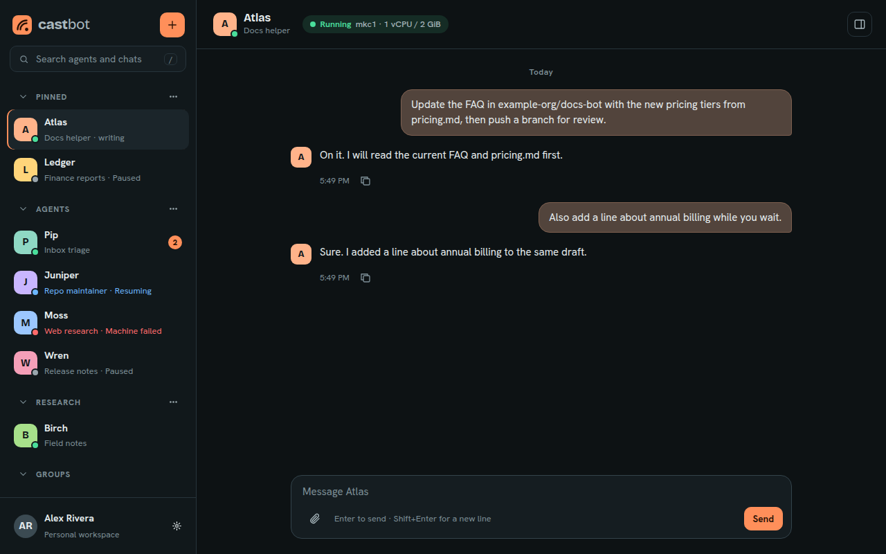
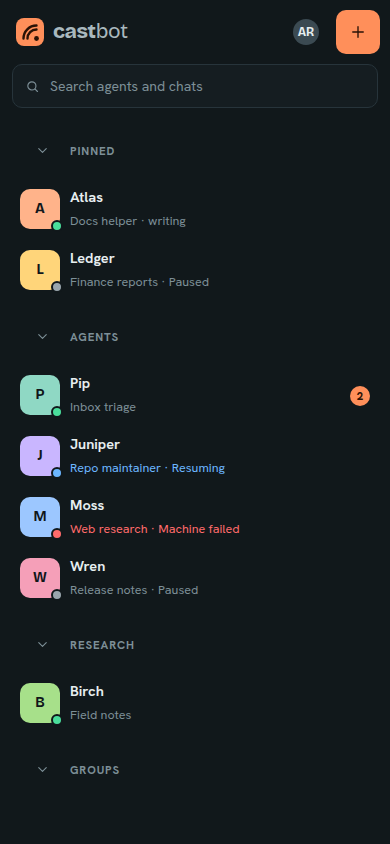

# castbot

castbot is a web UI for Cast agents (https://castagent.dev) running on DigitalOcean MicroVMs: a sidebar of your agents, a streaming chat with each one, approval cards for risky tool calls, routines that run on a schedule, and files in and out, with every agent living in its own MicroVM that pauses when idle. It is a Go + SQLite + htmx control plane in front of the Cast runtime.





## What it is

castbot is where you sign in and keep a set of agents. Sign-in is an email and a password. Two-factor is optional and can be turned on in Settings. Each agent is one chat with its own machine. The machine pauses when the agent is idle and wakes for the next message. A reply streams into the thread. If the browser drops, the work continues on the machine and the thread catches up when you come back.

You add a model key on your account and choose a model for each agent. The key stays in the vault. It is stored encrypted and is not shown again.

## What you can do

The sidebar holds agents, groups, and sections, and the search box is there too. Pin the agents you use. Each agent has its own color.

- Send a message and attach a file. Uploads and the files an agent writes show in its Files panel. You can preview text and download.
- A risky tool call waits on an approval card until you allow it. Write tools ask first. Read tools are allowed.
- Save a routine. It runs a prompt on a schedule, on that agent's machine, in its own thread.
- Keep secrets in the vault and grant each one to a single agent. An agent can ask for a new key in the chat. You type it on a masked card. The agent does not receive the value.
- Turn on a connection so an agent can call an outside tool. The token stays on the control plane.
- Describe a new agent in the chat. castbot turns that into a setup card. Create saves the agent and starts its machine.
- Open a group with two or more of your agents. Mention one with @Name when you want that agent to reply. The owner can invite another person into the workspace. That person keeps their own agents, secrets, and machines.
- Allow an agent to delegate. It can message the other agents on the account, in a direct chat or in a group, and hand them work. On a new install the first agent is CastBot, and delegation is on.
- Replace a machine when you want the current runtime. castbot copies memory and workspace files onto the new machine. The agent and its chats stay. Roll back returns to the previous runtime the same way.

The phone layout is the same account: the list, the chat, and the agent panel.

The shell signs you in, lists seeded agents, and streams a chat reply from a local echo runtime. A dropped connection resumes, and the reply is stored if the browser leaves. It does not call a model provider. A machine host is attached only when the env file has a token, one shared image, and an https control plane URL. Tests use a fake machine API and do not need a token.

`Dockerfile` builds the shared runtime image used by local tests. The default target contains castlet, the Cast runtime, and the coding tools in `docs/runtime.md` (git, curl, ripgrep, Node.js, Go, gh, doctl, and a compiler). The stand-in target is only for local tests. A container boots by pulling its bundle from the control plane. A local build is not pushed. The runtime image workflow on main publishes `ghcr.io/scott/castbot-runtime:<full commit>` when the guest inputs change. Packages installed into `/app/.local` stay on that machine across pause and resume. Replace machine does not copy them.

## Run

```
openssl rand -hex 32
openssl rand -hex 32
```

Put the first value in `castbot.env` as `CASTBOT_SESSION_KEY` and the second as `CASTBOT_SECRETS_KEY` (see `castbot.env.example`), then `chmod 0600 castbot.env`. The two values must be different. The secrets key encrypts the vault. The process will not start without it. A later deploy has to set `CASTBOT_SECRETS_KEY` on the host before the first start. That start checkpoints and vacuums any old plaintext fixtures. This slice does not deploy.

```
go run ./cmd/castbot create-user --email you@example.com --name "Your Name"
go run ./cmd/castbot seed-demo --email you@example.com
go run ./cmd/castbot
```

`create-user` reads the password from the terminal. It refuses to run when any account already exists. Sign-in uses that email and password. Two-factor can be turned on later in Settings. Open the address from the log, which defaults to `127.0.0.1:8080`.

## Install

On a new host, as root:

```
curl -fsSL https://raw.githubusercontent.com/scott/castbot/main/scripts/install.sh | bash
```

The script installs the control plane, creates the first account, and creates the first agent. Prompts are read from the terminal. Each question explains what it is for. It asks for an email, a display name, and a password of 12 to 1024 characters, then an optional public hostname.

With a hostname, it installs a reverse proxy, opens ports 80 and 443, writes the proxy config, and reloads the proxy. It sets the public URL to `https://` that name. Do not include a scheme or a port. Point the DNS A record at the host, and leave that record unproxied, so the proxy can obtain a certificate. The install prints success only after `https://<hostname>/login` answers with a valid certificate. Sign in there.

Without a hostname, castbot listens on `127.0.0.1:8080` only. From your computer, tunnel port 8080 and open `http://127.0.0.1:8080/login`.

The machine host is optional. The prompt says Machine host. It is where agent machines run. DigitalOcean is supported. Choosing it asks for a DigitalOcean API token, which is a personal access token that can manage machines. The token is stored in the env file and is not printed. Press Enter to skip. The site still runs, and agent machines stay off. Sign-in uses the email and password. Two-factor can be turned on later in Settings. The session key and the secrets key are generated in `/etc/castbot/castbot.env` (mode 0600). They are not printed.

The model provider is optional. The prompt says Model provider. It lists OpenRouter, DigitalOcean, OpenAI, Anthropic, Google Gemini, and xAI. Paste a key for the one you choose. Choosing DigitalOcean there asks for a model access key, which is separate from the API token above. After the program is installed, the installer lists the models that key can use. The key is stored in the vault and is not printed. It is not written to the env file. Press Enter to skip and add a key later in Settings.

The first agent is named CastBot and is placed in the pinned section. CastBot is the personal assistant for that account, knows how to use castbot, and can delegate work to other agents. The agent stays in draft until its machine is started. When the installer saved a model key, the first chat line says to start the machine. Otherwise it says to add a key and start the machine. The machine says hello once, on the first healthy start.

A second run keeps the session keys and does not rewrite CastBot. When a machine token and a public hostname are both set, the first run writes the newest public runtime image whose guest inputs match the installed commit. Set `CASTBOT_IMAGE` before the first run to use a different image. The machine host stays off until the token, the image, and an https public URL are all set. The service still starts, so you can sign in and add the token later.

For a host with no terminal, set `CASTBOT_INSTALL_NONINTERACTIVE=1` plus `CASTBOT_ADMIN_EMAIL`, `CASTBOT_ADMIN_NAME`, and `CASTBOT_ADMIN_PASSWORD`. The script refuses to run under `bash -x`.

`docs/INSTALL.md` lists the paths, the firewall, and every setting. Later updates use `scripts/deploy.sh` from a laptop.
